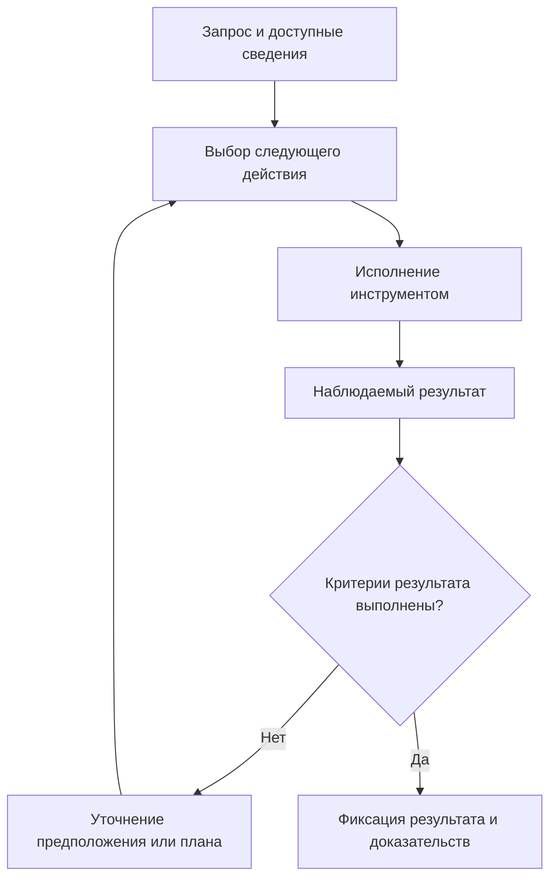

# Как агент создаёт решение: исследование и проект рабочего порядка

Дата исследования: **1 октября 2026 года**.

Статус: **первичный обзор первоисточников и предлагаемый практический порядок**. Сравнительные испытания этого порядка на собственном наборе задач ещё не проводились.

Связанный документ: [рабочий цикл и гигиена проекта](WORKFLOW.md).

Практическое применение предложенного порядка: [стартовый комплект для новых проектов](README.md). Проверки комплекта подтверждают создание и структуру файлов; сравнительная эффективность процесса решения задач пока не измерена.

Основной вопрос: как перейти от запроса человека к обоснованному, работающему и проверенному решению с помощью языковой модели и её инструментов.

## 1. Что именно изучается

Нужно различать три уровня:

| Уровень | Что происходит | Что можно исследовать и проверять |
|---|---|---|
| Языковая модель | По доступному входу вырабатывает продолжение: ответ, вариант решения, план или запрос к инструменту | Входы, выходы, ограничения известных механизмов; для внутренних причин нужны специальные исследования |
| Агентская система | Передаёт контекст модели, исполняет обращения к инструментам, возвращает наблюдения и поддерживает продолжение работы | Доступные документы, вызовы инструментов, изменения файлов, результаты выполнения, сохранённое состояние |
| Разработка решения | Определяет задачу, исследует обстоятельства, выбирает подход, реализует и проверяет результат | Соответствие потребности, факты, альтернативы, критерии выбора, работоспособность и удобство |

Основной предмет этого документа — второй и третий уровни. Первый описан в объёме, необходимом для понимания ограничений. Описанная ниже последовательность — предлагаемый порядок организации работы, а не утверждение, что любая модель сама обязательно проходит одинаковые стадии.

## 2. Что известно о механизме

### 2.1. Как появляется текст ответа

В обычной авторегрессионной языковой модели вход разбивается на токены — фрагменты текста. Модель вычисляет распределение вероятностей следующего токена, процедура генерации выбирает продолжение, и оно участвует в последующих шагах. Так последовательно формируется ответ. Это описание механизма генерации; оно само по себе не объясняет причину каждого конкретного инженерного выбора. [Документация Transformers о генерации](https://huggingface.co/docs/transformers/v4.36.0/llm_tutorial).

Практическое следствие для нашего порядка: надо контролировать доступные сведения и качество результата, а не считать убедительность формулировки доказательством правильности.

### 2.2. Как появляется работающий агент

В агентской системе модель получает задачу и доступное состояние, выбирает действие, инструмент исполняет его, а результат возвращается модели. Следующее действие выбирается уже с учётом наблюдения. Исследование ReAct рассматривает чередование рассуждения и действий, в том числе получение сведений из внешней среды. Это один из изученных подходов, а не обязательное описание внутренней работы всех современных моделей. [Исследование ReAct](https://arxiv.org/abs/2210.03629).

Anthropic различает заранее заданные процессы и агентов, которые выбирают дальнейшие действия динамически. Для последних особенно важны наблюдения из среды, понятные инструменты и условия остановки. [Инженерное описание агентских систем](https://www.anthropic.com/engineering/building-effective-agents).

Упрощённая схема наблюдаемого цикла:



Это схема внешней организации работы. В ней намеренно показаны проверяемые действия и результаты.

### 2.3. От чего зависит результат помимо самой модели

В работе SWE-agent изучалось влияние интерфейса инструментов на решение задач разработки. Способы поиска, чтения, редактирования и запуска проверок повлияли на результаты экспериментов. Следовательно, при сравнении агентов нужно учитывать среду и инструменты вместе с моделью. Численные результаты того исследования нельзя автоматически переносить на нынешние модели и наш проект. [Исследование SWE-agent](https://arxiv.org/abs/2405.15793).

Материал о работе с контекстом описывает постепенное получение нужных сведений, короткие указатели на источники, сжатие истории и сохранение заметок. Полезность контекста зависит от его состава, а увеличение объёма само по себе не гарантирует улучшения. [Работа с контекстом агентов](https://www.anthropic.com/engineering/effective-context-engineering-for-ai-agents).

Практический вывод для проекта: карта модулей, хорошие инструменты и ясные критерии проверки относятся к механизму получения решения. Их нужно оценивать по тому, помогают ли они выполнить задачу.

### 2.4. Какие выводы нельзя делать по одному ответу

В исследовании 2025 года модели не всегда отражали в описании рассуждения подсказки, которые влияли на ответ. Это ограничивает использование текстового объяснения как полного отчёта о внутренних причинах выбора. Результат относится к исследованным моделям и условиям; он не означает, что всякое объяснение бесполезно. [Исследование достоверности объяснений](https://arxiv.org/abs/2505.05410).

Исследование 2023 года обнаружило ограничения исправления рассуждений без внешней обратной связи: повторная самостоятельная оценка иногда ухудшала результат. Это историческое свидетельство для конкретных испытаний, а не доказательство неспособности всех нынешних моделей к самопроверке. [Исследование самостоятельного исправления](https://arxiv.org/abs/2310.01798).

Для нашего порядка разумно сохранять короткое проверяемое обоснование: какие факты использованы, какие варианты рассмотрены, почему выбран этот и чем проверен результат. Повторная уверенная оценка того же ответа не заменяет новые сведения или проверку выполнения.

## 3. Чего не хватало в первоначальном рабочем цикле

Первоначальный документ подробно описывает сопровождение изменения: чтение правил, работу с кодом, проверки, слияние, выпуск и передачу контекста.

Перед реализацией нужно подробнее описать создание самого решения:

1. Как из запроса выделяется потребность человека.
2. Как определяется наблюдаемый успешный результат.
3. Как отделяются подтверждённые сведения от предположений.
4. Какие неизвестные действительно могут изменить решение.
5. Как появляются и сравниваются варианты.
6. Как проверяется наиболее рискованное предположение до большой реализации.
7. По каким наблюдениям выбранный подход нужно пересмотреть.

Дальнейший порядок — наша рабочая гипотеза, собранная с учётом источников и практики проекта. Его пользу необходимо проверить на собственных задачах.

## 4. Предлагаемый порядок создания решения

| Этап | Действие агента | Проверяемый результат этапа |
|---|---|---|
| 1. Понять потребность | Определить, кому и в какой ситуации нужен результат, что сейчас мешает и что человек хочет изменить | Короткая формулировка задачи, привязанная к ситуации использования |
| 2. Задать критерии | Сформулировать ожидаемое поведение, ограничения и существенные исключения | Наблюдения, по которым можно принять или отклонить решение |
| 3. Собрать сведения | Изучить текущую реализацию, реальные данные, документы и подходящие первоисточники | Подтверждённые факты со ссылками, отдельно предположения и неизвестные |
| 4. Выделить ключевую неопределённость | Определить, какой неизвестный факт способен сделать выбранное направление неверным | Конкретный вопрос и способ его проверки |
| 5. Сравнить варианты | Рассмотреть жизнеспособные способы решения и существующие возможности системы | Сравнение по одним критериям и объяснимый выбор |
| 6. Проверить рискованный участок | Выполнить небольшой опыт, расчёт, макет или прототип, если неопределённость этого требует | Наблюдение, подтверждающее или опровергающее главное предположение |
| 7. Реализовать связный результат | Встроить выбранный подход в существующую систему с учётом реального пользовательского пути | Работающая цепочка, включающая необходимые данные, действия и состояния |
| 8. Принять результат | Проверить потребность, поведение, ограничения и последствия изменения | Доказательства по исходным критериям и явно названные ограничения |

Этапы могут повторяться. Неудачный опыт возвращает к предположению или выбору подхода. Проверка в конце не должна подменять исходную задачу более удобной для исполнителя.

### Как выбирать степень подробности

Для понятной небольшой правки достаточно нескольких предложений и подходящей проверки. Для нового поведения с неизвестными ограничениями требуется исследование и сравнение. Полный набор документов ради каждой задачи не нужен.

Правило четырёх вариантов в исходном проекте — местная дисциплина для нетривиального выбора. Исследование не устанавливает, что именно четыре варианта оптимальны для любой задачи. Сравниваемые варианты должны быть жизнеспособными и различаться по существу.

### Когда нужен вопрос человеку

Вопрос нужен, если неизвестное предпочтение или ограничение существенно меняет результат: например, кто основной пользователь или какое действие считается успешным. Если выбор обратим и не затрагивает такие развилки, агент может явно обозначить рабочее предположение и продолжить независимую часть задачи.

### Когда нужно искать сведения

Поиск должен отвечать на конкретную неопределённость. Для устройства существующего проекта первыми источниками будут код, данные и рабочие документы. Для неизвестного внешнего подхода, изменчивой технологии или спорного утверждения — первоисточники и проверка применимости к нашей задаче.

Полезная запись исследования содержит: вопрос, найденный факт, источник, влияние на выбор и оставшееся ограничение. Количество просмотренных страниц само по себе не показывает, что решение стало лучше.

### Как сравнивать варианты

Критерии выбираются из задачи: соответствие потребности, удобство, совместимость, сложность сопровождения, стоимость исполнения и риск. Вместе с выбранным вариантом фиксируется условие пересмотра: какой новый факт заставит изменить решение.

## 5. Пример применения

**Условный пример проектной работы:** участник не понимает, как передать выполненную задачу на проверку.

- Потребность: увидеть доступное следующее действие в карточке задачи.
- Критерий: участник с нужными правами может передать задачу на проверку и увидеть её новый статус.
- Факты для проверки: какие действия доступны в карточке, где находится кнопка и как её доступность зависит от роли и состояния задачи.
- Возможные причины: действие незаметно; подпись не объясняет результат; состояние доступа не показывает следующий шаг.
- Варианты решения: изменить расположение действия, уточнить подпись, улучшить отображение статуса или исправить проверку доступности — по установленной причине.
- Первый опыт: проверить наиболее вероятную причину на текущем экране или небольшом макете.
- Приёмка: пройти путь от открытия карточки до подтверждённого изменения статуса, включая существенные ограничения доступа.

Так задача связывает пользовательскую потребность, проверку причины, выбор изменения и итоговую приёмку.

## 6. Как оценивать полученное решение

В материале об оценке агентов отдельно рассматриваются запись попытки и фактический результат в среде. Сообщение об успешном действии не доказывает, что нужное изменение существует. Также различаются программные, модельные и человеческие способы оценки; каждый проверяет подходящую ему часть результата. [Оценка работы агентов](https://www.anthropic.com/engineering/demystifying-evals-for-ai-agents).

Для нашего порядка предлагается проверять следующие вопросы:

| Вопрос | Подходящее подтверждение |
|---|---|
| Решена ли исходная потребность? | Выполнение пользовательского сценария и проверка по исходным критериям |
| Правильно ли работает механизм? | Проверки контрактов, данных, ошибок и существенных крайних случаев |
| Согласовано ли решение с системой? | Проверка архитектурных правил и затронутых связей |
| Удобно ли им пользоваться? | Наблюдение за выполнением задачи; при необходимости проверка с пользователем |
| Не добавлена ли ненужная сложность? | Обоснование новых частей и сравнение с доступными существующими средствами |
| Можно ли продолжать сопровождение? | Понятные изменения, документация и передаваемый контекст |

Автоматический тест проверяет заложенные в него условия. Оценка другой моделью может помочь найти проблемы, но требует проверки её замечаний. Для открытых вопросов удобства и приоритетов сохраняется роль человека.

## 7. Как сохранять ход решения между сессиями

Исследование длительной работы агентов описывает проблемы слишком широких изменений, преждевременного объявления готовности и потери контекста. В показанной авторами системе использовались небольшие последовательные изменения, список проверяемых возможностей и записи для следующей сессии. Это опыт конкретной системы, который нужно адаптировать к масштабу проекта. [Длительная работа агентов](https://www.anthropic.com/engineering/effective-harnesses-for-long-running-agents).

Для нашей практики достаточно сохранять компактную запись:

```text
Задача и пользовательская потребность:
Критерии результата:
Подтверждённые факты и источники:
Предположения и существенные неизвестные:
Рассмотренные варианты:
Выбранный подход и причина:
Условие пересмотра:
Проверка рискованного предположения:
Что реализовано:
Что проверено и с каким результатом:
Следующий необходимый шаг:
```

Эта запись может быть частью журнала сессии или описания задачи. Отдельный новый файл нужен только тогда, когда объём и срок жизни материала это оправдывают.

## 8. Что ещё нужно проверить на практике

Следующий исследовательский шаг — сравнить предлагаемый порядок с обычным выполнением задач. Это **план испытаний**, а не уже полученные результаты.

- Взять небольшой заранее определённый набор задач разных типов: локальная ошибка, новая функция, пользовательский путь и изменение с архитектурным ограничением.
- Для каждого сравнения сохранить одинаковую исходную версию, модель, доступные инструменты и сопоставимый бюджет работы.
- Заранее задать критерии приёмки и проверять результат отдельно от объяснения исполнителя.
- Повторять попытки, поскольку один удачный запуск не характеризует надёжность процесса.
- Сравнивать долю принятых решений, время до принятия, стоимость выполнения, число возвратов из-за неверных предположений и найденные после завершения дефекты.
- Учитывать затраты на сам порядок: дополнительные документы и обсуждения должны давать измеримую пользу.

Особенно полезно проверить влияние ранних критериев приёмки, проверки главной неопределённости до реализации и короткой передачи контекста между сессиями. Польза строго заданного количества вариантов и дополнительного модельного рецензента также требует отдельной проверки.

## 9. Источники и границы исследования

Источники найдены через EXA и обычный веб-поиск. Использованы научные работы и материалы авторов инструментов. Прямые цитаты не воспроизводились; положения изложены своими словами со ссылками рядом с соответствующими утверждениями.

| Источник | Дата материала | Для чего использован |
|---|---|---|
| [Документация Transformers, версия 4.36.0](https://huggingface.co/docs/transformers/v4.36.0/llm_tutorial) | Версионированная документация | Базовый механизм последовательной генерации |
| [ReAct](https://arxiv.org/abs/2210.03629) | 2022; конференционная публикация 2023 | Цикл действий и наблюдений |
| [SWE-agent](https://arxiv.org/abs/2405.15793) | 2024 | Влияние интерфейса инструментов на работу агента |
| [Построение эффективных агентов](https://www.anthropic.com/engineering/building-effective-agents) | 19 декабря 2024 | Различие заданных процессов и динамических агентов |
| [Работа с контекстом](https://www.anthropic.com/engineering/effective-context-engineering-for-ai-agents) | 29 сентября 2025 | Постепенное получение сведений и организация памяти |
| [Длительная работа агентов](https://www.anthropic.com/engineering/effective-harnesses-for-long-running-agents) | 26 ноября 2025 | Продолжение задач через несколько сессий |
| [Оценка агентов](https://www.anthropic.com/engineering/demystifying-evals-for-ai-agents) | 9 января 2026 | Различие записи работы и фактического результата |
| [Ограничения самостоятельного исправления](https://arxiv.org/abs/2310.01798) | 2023 | Ограничения проверки без внешней обратной связи |
| [Достоверность объяснений рассуждающих моделей](https://arxiv.org/abs/2505.05410) | 2025 | Ограничения вывода о причинах ответа по его объяснению |

Это первичный обзор, а не исчерпывающий обзор всей литературы и не рейтинг современных моделей. Источники подтверждают отдельные механизмы и наблюдения. Предложенный порядок, шаблон записи и план испытаний являются рабочими решениями для этого проекта; их эффективность пока не измерена.
